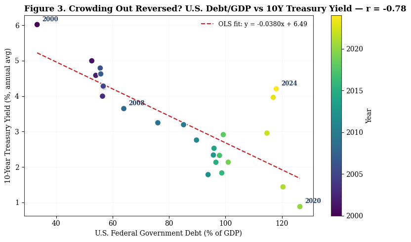

# Oil Shocks, Interest Rates, and Crowding Out

**How energy prices transmit to inflation, interest rates, equity markets and private investment, 2000–2026**

Zachary Lenz · Intermediate Income Theory · May 2026 · [Read the paper (PDF, 7 pp.)](Oil_Shocks_Interest_Rates_Crowding_Out.pdf)

## Question
The paper starts from the Federal Reserve Board's DSGE estimate of the 2022 oil shock's effect on U.S. inflation (Presno & Prestipino, 2024). It then tests three textbook macro models (AS-AD, IS-LM and loanable-funds crowding out) against U.S. and cross-country data.

## Findings
| Model | Prediction | Evidence | Result |
|---|---|---|---|
| AS-AD | Oil shocks raise inflation | WTI YoY change vs. CPI, 2000–2024: **r = +0.65** | Supported |
| Loanable funds | Higher federal debt raises long rates | Debt/GDP vs. 10Y Treasury yield: **r = −0.78** | Contradicted |
| Cross-country | High debt slows growth | Debt/GDP vs. GDP growth, n = 101: **r = −0.19** | Weakly supported |

The textbook model gets the destination right (slower growth) but the mechanism wrong. Deficits and falling yields arrive together because the Fed cuts rates and expands its balance sheet during the same downturns that produce large deficits.

<p align="center"></p>

**Method:** Pearson correlations and OLS fits on annual, monthly and cross-sectional data. Cross-country values are winsorized at the 2.5/97.5 percentiles. The results are associations, not causal estimates. §5 of the paper discusses identification limits.

## Contents
```
Oil_Shocks_Interest_Rates_Crowding_Out.pdf   final paper
notebooks/oil_shocks_analysis.ipynb          data pulls, cleaning, figures and statistics
data/                                        U.S. annual, monthly market and cross-country datasets
figures/                                     figures 1–4 as used in the paper
```

**Data sources:** World Bank WDI API (U.S. macro), Yahoo Finance via `yfinance` (WTI, S&P 500, 10Y yield), cross-country snapshot of 173 economies.
**Tools:** Python (pandas, NumPy, matplotlib, requests, yfinance).
